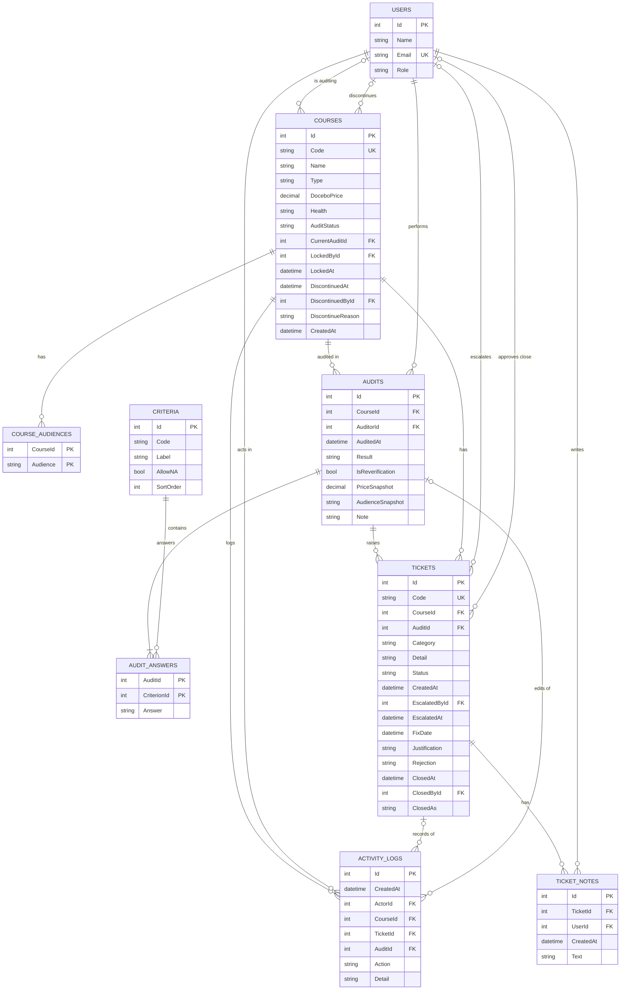

# Database schema

Course Audit Central 以后变成真网站时的数据库设计。现在的 demo 把数据存在浏览器的 localStorage（`courses`、`audits`、`tickets`、`logs`），真网站会把它们拆成下面 9 张表。

## ER 图

## 怎么看这张图

**字段标记**

| 标记 | 意思 |
|---|---|
| PK | Primary Key，主键，每一行的唯一编号 |
| FK | Foreign Key，外键，指向另一张表的 PK |
| UK | Unique Key，值不能重复 |

两个字段都标 PK（例如 `AUDIT_ANSWERS` 的 `AuditId` + `CriterionId`）叫 **复合主键**：两个合起来不能重复，也就是同一次 audit 的同一条 criterion 只能有一个答案。

**关系符号**（线的两头）

| 符号 | 意思 |
|---|---|
| `\|\|` | 刚好一个 |
| `\|o` | 零个或一个 |
| `o{` | 零个或多个 |
| `\|{` | 一个或多个 |

例如：
- `COURSES ||--o{ AUDITS`：一门课有零到多次 audit，每次 audit 属于刚好一门课。
- `AUDITS ||--|{ AUDIT_ANSWERS`：每次 audit 至少有一个答案（实际上是 8 个）。
- `USERS |o--o{ TICKETS`：ticket 刚创建时还没有人 escalate，所以 `EscalatedById` 可以是空的。
- `USERS |o--o{ COURSES : "is auditing"`：同一时间最多一个人在 audit 一门课（`LockedById`），没人在做时是空的。

## 状态字段的固定值

这些字段只能是下面几个值（可以用 C# 的 `enum`，或另外一张小表）：

| 字段 | 可能的值 |
|---|---|
| `USERS.Role` | `Auditor`、`SELM`、`CourseOwner` |
| `COURSES.Health` | `Pending Audit`、`Unhealthy`、`Healthy`、`Discontinued` |
| `COURSES.AuditStatus` | `Pending`（等 auditor）、`In Progress`（这一轮的 ticket 还没处理完）、`Completed` |
| `AUDITS.Result` | `Passed`、`Failed` |
| `AUDIT_ANSWERS.Answer` | `Yes`、`No`、`N/A` |
| `TICKETS.Category` | `Content`、`Edutube`、`Course Setup`、`Learning Plan Setup`、`Pricing`、`CD PDF`、`IT issue`、`Other` |
| `TICKETS.Status` | `New`、`Escalated`、`In Progress`、`Retest Failed`、`Pending Verification - Resolved`、`Pending Verification - Cancelled`、`Closed` |
| `TICKETS.ClosedAs` | `Resolved`、`Cancelled` |

课程列表上的 To audit / Unhealthy / Ready to check / Healthy / Discontinued **不用另外存**，可以从 `Health`、`AuditStatus`、`LockedById` 和还没关的 ticket 算出来。

## 每张表的用途

| 表 | 存什么 | 对应 demo 的 |
|---|---|---|
| USERS | 用户和角色（Auditor / SELM / CourseOwner） | `USERS` 常数 |
| COURSES | 课程、Docebo pricing、目前状态、谁正在 audit、下架资料 | `S.courses` |
| COURSE_AUDIENCES | 课程的 catalog audience，可以多选（Partner、DSP、Customer、Tailored、TD） | `course.audience` 字符串 |
| CRITERIA | 固定的 8 条 criteria（H–O），只有前三条 `AllowNA = true` | `CRITERIA` 常数 |
| AUDITS | 每一次 audit | `S.audits` |
| AUDIT_ANSWERS | 每次 audit 的每条 criteria 答案：Yes / No / N/A | `audit.checklist` 数组 |
| TICKETS | 每个 issue 一张 ticket | `S.tickets` |
| TICKET_NOTES | SELM 在 ticket 上留的 note | `ticket.notes` 数组 |
| ACTIVITY_LOGS | 所有修改记录（谁、什么时候、做了什么） | `S.logs` |

## 设计重点

1. **存用户 Id，不存名字。** demo 存的是名字，所以改名字时要写 `OLD_NAMES` 去替换旧数据。存 Id 的话，改名字只要改 `USERS` 的一行。
2. **多选和列表拆成另一张表。** audience 和 8 个答案在 demo 里是字符串或数组；在数据库里拆开，才能做统计，例如"哪条 criteria 最常是 No"。
3. **算得出来的不存。** demo 的 `auditCount`、`lastAudited`、`lastAuditor` 可以从 `AUDITS` 算出来，存了反而可能对不上。
4. **Criteria 是数据，不是代码。** 以后要加第 9 条，或改哪几条可以 N/A，只要改 `CRITERIA` 表。
5. **Ticket 的拥有者是 `EscalatedById`。** 只有 escalate 的那个 SELM 可以更新这张 ticket，服务器端要检查这一点。
6. **Pricing 用 `decimal(10,2)`，不用文字。** 文字可以输入任何东西（例如 `fdafasd`），也不能计算、比较或正确排序；金额也不要用 `float`，会有小数误差。空的（null）代表还没填。
7. **Audit 记下当时的 pricing 和 audience**（`PriceSnapshot`、`AudienceSnapshot`），这样课程之后被修改，旧的 audit 还看得到当时的值。
8. **AUDITS 只在提交时才写入。** 打开 audit 表单只是锁定课程（`LockedById`、`LockedAt`），中途放弃的话不会留下任何 audit 记录，课程状态也不变。
9. **下架的课程不删除。** `Health = Discontinued` 加上 `DiscontinuedAt / ById / Reason`，资料和历史都保留，可以 restore。只有从来没 audit 过的课程才真的删除（`DELETE`）。
10. **Criteria 改了要留下痕迹。** Auditor 用 Edit criteria 改答案时，`AUDIT_ANSWERS` 直接更新成新的答案，同时在 `ACTIVITY_LOGS` 写一笔 `Action = Criteria updated`、`AuditId` 指向那次 audit、`Detail` 写 "Launch URL works: No → Yes"。这样画面可以在那次 audit 下面列出修改记录，也能倒推出最原本的答案。
11. **Cancel 和 Discontinue 是不同层级。** Cancel 只关一张 ticket（`ClosedAs = Cancelled`）；Discontinue 是整门课下架。

## 规则（服务器端要检查）

- `AUDIT_ANSWERS.Answer` 只能是 `Yes`、`No`、`N/A`；`N/A` 只在 `CRITERIA.AllowNA = true` 时允许。
- 有任何 `No` 就一定要开至少一张 ticket。
- 还有 ticket 没关时，这次 audit 至少要留一个 `No`。
- 全部 ticket 关闭后，自动建一次 re-verification audit（`IsReverification = true`），答案全部是 `Yes`，原本 `N/A` 的保持 `N/A`。
- SLA：`Status = Escalated`、`FixDate` 是空的、而且 `EscalatedAt` 超过 7 天，就算超时。
- 一门课同一时间只能有一个人 audit（`LockedById`）；锁太久没提交（例如超过一天）要自动解除。
- Re-audit 时课程保持 `Healthy`，直到提交结果；re-audit 要有 `No`，或有答案改变（例如 Yes → N/A）才能提交；完全没变就取消，不留记录。有 `No` 提交后变成 `Unhealthy`，只改成 N/A 的话保持 `Healthy`。
- 只有 escalate 的 SELM（`EscalatedById`）可以更新、Resolve 或 Cancel 那张 ticket；只有 Auditor 可以 Approve 或 Reject。
- Ticket 填了 `FixDate` 就从 `Escalated` 变成 `In Progress`。
- Cancel ticket 一定要写原因（存在 `Justification`），Auditor 确认后 `ClosedAs = Cancelled`，课程不会下架。
- Discontinue 课程：只有 Auditor 或 Course Owner 可以做，一定要写原因；还没关的 ticket 全部变成 `Closed`、`ClosedAs = Cancelled`。
- Restore 课程：只有 Auditor；课程变回 `Pending Audit`、`AuditStatus = Pending`，等新的 audit。
- Delete 课程：只有在这门课**没有任何 audit 和 ticket** 时才允许。
- Pricing 和 Audience：在 audit 表单里填；之后只有课程是 `Unhealthy`（ticket 处理中）时，Auditor 或 SELM 才能在课程页直接改，`Pending Audit`、`Healthy`、`Discontinued` 和 audit 进行中都不能改（re-audit 也不能改；Healthy 的课程要先 re-audit 标出 No、变成 Unhealthy 后才能改）；每次修改都写进 `ACTIVITY_LOGS`。
