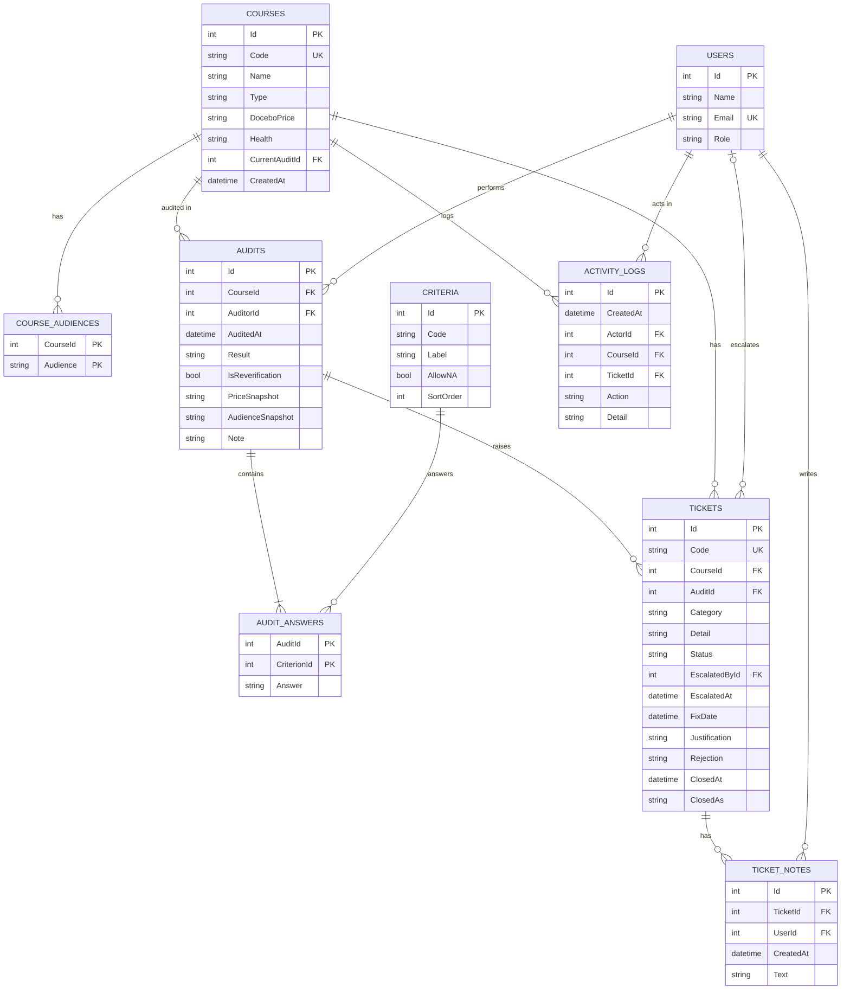

# Database schema

Course Audit Central 以后变成真网站时的数据库设计。现在的 demo 把数据存在浏览器的 localStorage（`courses`、`audits`、`tickets`、`logs`），真网站会把它们拆成下面 9 张表。

## ER 图

## 怎么看这张图

**字段标记**

| 标记 | 意思 |
|---|---|
| PK | Primary Key，主键，每一行的唯一编号 |
| FK | Foreign Key，外键，指向另一张表的 PK |
| UK | Unique Key，值不能重复 |

两个字段都标 PK（例如 `AUDIT_ANSWERS` 的 `AuditId` + `CriterionId`）叫 **复合主键**：两个合起来不能重复，也就是同一次 audit 的同一条 criterion 只能有一个答案。

**关系符号**（线的两头）

| 符号 | 意思 |
|---|---|
| `\|\|` | 刚好一个 |
| `\|o` | 零个或一个 |
| `o{` | 零个或多个 |
| `\|{` | 一个或多个 |

例如：
- `COURSES ||--o{ AUDITS`：一门课有零到多次 audit，每次 audit 属于刚好一门课。
- `AUDITS ||--|{ AUDIT_ANSWERS`：每次 audit 至少有一个答案（实际上是 8 个）。
- `USERS |o--o{ TICKETS`：ticket 刚创建时还没有人 escalate，所以 `EscalatedById` 可以是空的。

## 每张表的用途

| 表 | 存什么 | 对应 demo 的 |
|---|---|---|
| USERS | 用户和角色（Auditor / SELM / CourseOwner） | `USERS` 常数 |
| COURSES | 课程、Docebo pricing、目前状态 | `S.courses` |
| COURSE_AUDIENCES | 课程的 catalog audience，可以多选（Partner、DSP、Customer、Tailored、TD） | `course.audience` 字符串 |
| CRITERIA | 固定的 8 条 criteria（H–O），只有前三条 `AllowNA = true` | `CRITERIA` 常数 |
| AUDITS | 每一次 audit | `S.audits` |
| AUDIT_ANSWERS | 每次 audit 的每条 criteria 答案：Yes / No / N/A | `audit.checklist` 数组 |
| TICKETS | 每个 issue 一张 ticket | `S.tickets` |
| TICKET_NOTES | SELM 在 ticket 上留的 note | `ticket.notes` 数组 |
| ACTIVITY_LOGS | 所有修改记录（谁、什么时候、做了什么） | `S.logs` |

## 设计重点

1. **存用户 Id，不存名字。** demo 存的是名字，所以改名字时要写 `OLD_NAMES` 去替换旧数据。存 Id 的话，改名字只要改 `USERS` 的一行。
2. **多选和列表拆成另一张表。** audience 和 8 个答案在 demo 里是字符串或数组；在数据库里拆开，才能做统计，例如"哪条 criteria 最常是 No"。
3. **算得出来的不存。** demo 的 `auditCount`、`lastAudited`、`lastAuditor` 可以从 `AUDITS` 算出来，存了反而可能对不上。
4. **Criteria 是数据，不是代码。** 以后要加第 9 条，或改哪几条可以 N/A，只要改 `CRITERIA` 表。
5. **Ticket 的拥有者是 `EscalatedById`。** 只有 escalate 的那个 SELM 可以更新这张 ticket，服务器端要检查这一点。
6. **Audit 记下当时的 pricing 和 audience**（`PriceSnapshot`、`AudienceSnapshot`），这样课程之后被修改，旧的 audit 还看得到当时的值。

## 规则（服务器端要检查）

- `AUDIT_ANSWERS.Answer` 只能是 `Yes`、`No`、`N/A`；`N/A` 只在 `CRITERIA.AllowNA = true` 时允许。
- 有任何 `No` 就一定要开至少一张 ticket。
- 还有 ticket 没关时，这次 audit 至少要留一个 `No`。
- 全部 ticket 关闭后，自动建一次 re-verification audit（`IsReverification = true`），答案全部是 `Yes`，原本 `N/A` 的保持 `N/A`。
- SLA：`Status = Escalated`、`FixDate` 是空的、而且 `EscalatedAt` 超过 7 天，就算超时。
